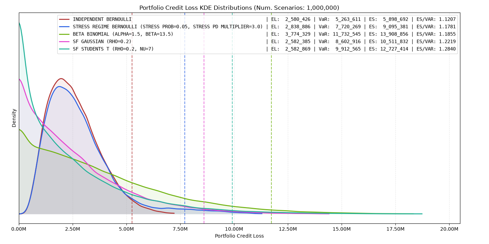
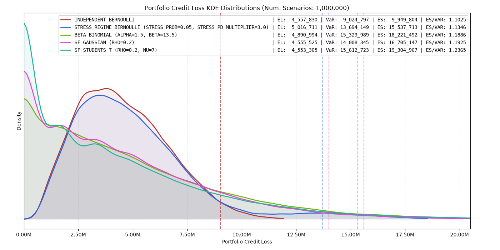
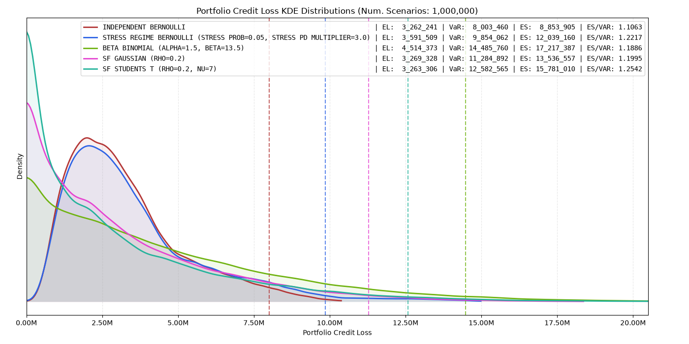
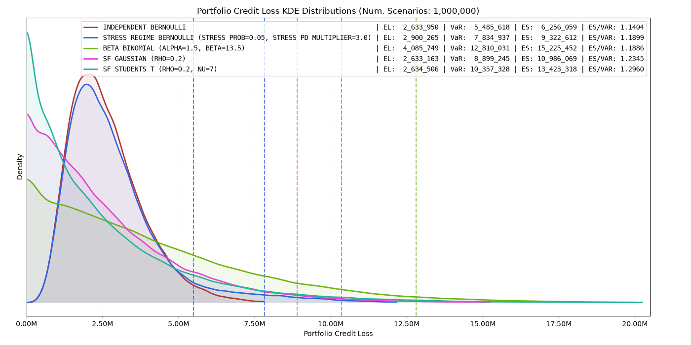

<!-- _class: lead -->

# RiskQuant · Credit VaR

## The Exec Deck

## *Measuring the losses that matter when counterparties fail together*


---


<!-- _class: lead -->

<style scoped>
  section {
    background-color: #E30076;
    text-align: center;
  }
  h1, em {
    color: #0F1114 !important;
    text-align: center;
  }
</style>

# FORBIDDEN MATERIALS

---

<!-- _class: lead -->

# RiskQuant · Credit VaR

## *Measuring the losses that matter when counterparties fail together*

---

<!-- _class: lead -->

# Part 1 · Credit VaR

<!-- ## *When one default becomes many* -->

<!-- > Credit VaR measures how assumptions about default dependence change the losses we must withstand. -->

---

# What Credit VaR Measures

Credit VaR answers one question: *if OTC counterparties default, what losses could our trading portfolio experience?*

> **Expected Loss tells us what we expect. Credit VaR measures what we must survive.**

| Component | Question | Determines |
|---|---|---|
| **Exposure** | How much value is at risk if a counterparty defaults? | The size of each loss |
| **Default probability** | How likely is each counterparty to default? | The average loss |
| **Default dependence** | How likely are counterparties to default together? | **The extreme losses (tail)** |

---

# Why Credit VaR Exists

**Expected Loss** measures the ***average counterparty credit loss***.

**Credit VaR** measures the ***tail losses that drive internal capital and risk appetite***.

| Expected Loss | Credit VaR |
|---|---|
| "What is our average credit loss?" | "What loss could we face in a severe event?" |
| Driven by exposure, PD and recovery | Driven by exposure, PD and **default dependence** |
| Measures the average impact of counterparty defaults | Measures the extreme outcomes that drive risk appetite and capital |

> The key uncertainty is not only whether counterparties default, but whether they *default together*.

---

# The Business Questions Behind the Tail

- **How much** could we lose in a severe counterparty event?
- **Which counterparties** contribute most to that tail?
- **Where are we concentrated** by counterparty, and in the shared risk driver?
- **How much diversification do we *actually* have** versus assume?
- **How resilient are we** if several counterparties fail together?

> Credit risk is difficult not because defaults are mysterious, but because they can *occur together*. Every model in this deck represents a different view of that dependence.

---


<!-- # The Core Data Behind Credit VaR

Credit VaR combines four inputs. The first two set the size of each loss; the last two set how often, and how *together*, those losses land.

| Input | Question answered | Source |
|---|---|---|
| **Exposure (EAD)** | How much is at risk if a counterparty defaults? | CCR exposure engine |
| **Loss severity (LGD)** | How much of that exposure is actually lost? | Obligor master |
| **Counterparty credit quality (PD)** | How likely is each counterparty to default? | Obligor master (ratings / market / assumptions) |
| **Default dependence** | How likely are defaults to occur together? | Factor universe & model calibration |

> At the core, every model computes the same thing: *loss = EAD × LGD when a default occurs.* PD sets the frequency; dependence sets the tail. -->

# The Core Data Behind Credit VaR

Credit VaR combines four inputs.

The first two determine the **size of a loss**.
The last two determine **how often losses occur and how severely they cluster**.

| Input | Question answered | Source |
|---|---|---|
| **Exposure (EAD)** | How much value is exposed if a counterparty defaults? | CCR exposure engine |
| **Loss severity (LGD)** | How much of that exposure is lost after recovery? | Counterparty credit data |
| **Counterparty credit quality (PD)** | How likely is each counterparty to default? | Ratings, market signals, credit assumptions |
| **Default dependence** | How likely are defaults to occur together? | Model assumptions & calibration |

> At the core, Credit VaR combines exposure, loss severity and default likelihood into a portfolio loss distribution. Dependence determines how much that loss grows in the tail.

---

# Where it Sits in the Risk Stack

- **CCR models** *size* exposure.
- **Credit VaR** turns exposure + default + dependence into a *loss distribution*.
- Credit risk comes from the possibility that a derivative has positive replacement value when the counterparty defaults.

```text
   Trades
     │
     ▼
   CCR Exposure Engine        valuation · netting · collateral · future exposure
     │
     ▼
   Counterparty Exposure  ──►  value at risk if they default
     │
     ▼
   Credit VaR Engine           default simulation · dependence · aggregation
     │
     ▼
   Loss Distribution      ──►  EL · VaR · ES · risk capital
```

---

<!-- _class: lead -->

# Part 2 · Jump-to-Default (JTD)

## *From counterparty defaults to portfolio loss distributions*

> A default creates a loss.
> Default dependence determines how severe the portfolio tail can become.

---

# Jump-to-Default (In a Nutshell)

**The event:** a counterparty defaults, and the positive value of our OTC portfolio becomes a credit loss.

We don't lend principal. Our credit risk is the **OTC portfolio**: firms owing us mark-to-market on unrealised trades.

**The loop, per scenario:**

1. Exposure at default → 2. Does the name default? → 3. Apply LGD → 4. Sum across the portfolio → 5. Repeat millions of times → **portfolio loss distribution**

> The whole modelling choice reduces to steps 2 and 4: **when one name defaults, how likely is the next?**

---

# What JTD Credit VaR Does Not Answer

JTD Credit VaR measures the loss **when default happens**.

It does not answer:

| Question | Owned by |
|---|---|
| How large could exposure become before default? | CCR modelling |
| What happens if markets gap? | Market risk |
| Does exposure increase as credit deteriorates? | Wrong-way risk analysis |
| How quickly can positions be closed? | Liquidity risk |
| How does credit quality deteriorate before default? | Credit migration models |

> JTD Credit VaR isolates default loss. It is one component of total counterparty risk.

---

# The One Choice That Moves Capital

| Driven by individual assumptions | Driven by dependence assumptions |
|---|---|
| **Expected Loss** | **The tail: VaR & ES** |
| Barely moves across models | Moves *enormously* across models |

Example: €100m exposure, 40% recovery → **€60m loss if it defaults.**

The marginal models agree on how often that costs us on average. They disagree on how often it happens *alongside twenty others.*

> Get the exposure and default assumptions right for average losses. Get the **dependence** right for tail risk.

---

# The Same Portfolio. Different Views of the Tail.

Each model answers the same question: **When one counterparty defaults, how much does it change the likelihood that others default too?**

| # | Model | Assumption added |
|---|---|---|
| 1 | Forced Default | Everything fails together |
| 2 | Independent Bernoulli | Defaults are unrelated |
| 3 | Beta-Binomial | Default rates can move higher or lower together |
| 4 | Stress-Regime Bernoulli | The market can enter a crisis state |
| 5 | Gaussian Copula | Counterparties share common risk drivers |
| 6 | Student-t Copula | Extreme tail dependence |

> Same portfolio. Same Expected Loss. The difference is the tail.

---

# 1 · Forced Default: *"assume everything fails all at once"*

**Intuition:** every counterparty defaults at once. No probability, no diversification.

**Answers:** *what is the absolute most we could lose?*

| Strengths | Weaknesses |
|---|---|
| Needs almost no data | Not a real scenario |
| A hard, un-arguable ceiling | Not suitable as a realistic capital estimate |

**Use it for:** a bounding sanity check, and brand-new (sub)portfolios with no history, hard stresses.

> The ceiling every other model must sit beneath.

---

# 2 · Independent Bernoulli: *"unrelated coin flips"*

**Intuition:** each counterparty is a separate weighted coin flip. One failing tells you nothing about the next.

**Answers:** *what does the loss look like if defaults are unrelated?*

| Strengths | Weaknesses |
|---|---|
| Simple, fast, full distribution | Forbids clustering entirely |
| Captures single-name concentration | **Understates the tail; flatters diversification** |

**Use it for:** granular, homogeneous (sub)portfolios; the baseline everything else is measured against.

> Its diversification benefit is overstated because counterparties share common drivers.

---

# 3 · Beta-Binomial: *"the default rate can move"*

**Intuition:** each counterparty has a default probability, but the portfolio default rate is not fixed. It moves from scenario to scenario.

**Answers:** *what happens when default probabilities are more uncertain than a fixed PD assumption implies?*

| Strengths | Weaknesses |
|---|---|
| Introduces volatility in portfolio default rates | Treats the portfolio as one homogeneous pool |
| Creates default clustering without specifying risk factors | No sector / geography / counterparty-specific drivers |

**Use it for:** portfolios where default uncertainty matters, but a full factor model is not required.

> The first model to admit that default probabilities move. That uncertainty alone creates clustering.

---

# 4 · Stress-Regime Bernoulli: *"dependence through scenarios"*

**Intuition:** counterparties can move together because the portfolio can enter different states of the world. In a stressed state, default probabilities increase across names.

**Answers:** *what happens when multiple counterparties become more likely to default under a defined stress scenario?*

| Strengths | Weaknesses |
|---|---|
| Makes default dependence explicit and interpretable | Reality is not always a small number of discrete states |
| Easy to link losses to defined stress scenarios | Requires judgement on stress severity and likelihood |

**Use it for:** stress testing, limit discussions, understanding portfolio behaviour under adverse scenarios.

> Dependence is introduced through explicit stressed states.

---

# 5 · Gaussian Copula: *the industry standard*

**Intuition:** each name is part idiosyncratic, part tied to a **shared economy.** When the economy dips, names weaken together and defaults cluster.

**Answers:** *how much diversification do we really have once counterparties share drivers?*

| Strengths | Weaknesses |
|---|---|
| Market & regulatory standard | One economy; single factor |
| Realistic clustering & diversification | Bell-curve tails understate joint crashes |

**Use it for:** portfolio tail risk measurement and counterparty risk capital.

> The workhorse, and the base the final model improves on.

---

# 6 · Student-t Copula: *"extremes cluster"*

**Intuition:** counterparties share common risk drivers, but extreme market conditions create stronger co-movement than a Gaussian model allows.

**Answers:** *how severe can portfolio losses become when defaults cluster in the tail?*

| Strengths | Weaknesses |
|---|---|
| Captures stronger tail dependence | Additional parameters require calibration |
| More realistic extreme-event behaviour | Can produce more conservative tail estimates |

**Use it for:** understanding extreme portfolio losses and stress scenarios where diversification breaks down.

> In normal conditions counterparties may diversify. In extreme conditions, that diversification can disappear.

---

# Comparing the Models: No Single Model Wins Everywhere

| Model | Realism | Transparency | Tail honesty | Data need | Business fit |
|---|---|---|---|---|---|
| Forced Default | – | High | – | Minimal | Stress bound |
| Independent Bernoulli | Low | High | Low | Low | Baseline view |
| Beta-Binomial | Med | High | Med | Low | Portfolio stress |
| Stress-Regime | Med | High | Med-High | Med | Scenario analysis |
| Gaussian Copula | High | Med | Med | Med-High | Core risk view |
| Student-t Copula | **High** | Med | **High** | Med-High | Extreme tail view |

> Transparency and realism pull in opposite directions. Simpler models are easier to explain; richer models capture more complex dependence. That is why you need a **suite**.

---

# Which Model Answers Which Question?

| The question we need to answer | Model |
|---|---|
| What is the absolute loss ceiling? | Forced Default |
| What if defaults are independent? | Independent Bernoulli |
| What if the portfolio default rate is higher or lower than expected? | Beta-Binomial |
| What happens in a defined stress scenario? | Stress-Regime Bernoulli |
| What if counterparties are exposed to the same economic drivers? | Gaussian Copula |
| What if extreme events create unusually strong clustering? | Student-t Copula |

> The objective is not to find the "right" model. It is to understand how much of the tail is created by our assumptions about dependence.

---

<!-- _class: lead -->

# Part 3 · Reading the Output

## *From loss distribution to risk decisions*

> The loss number is only the beginning. The real value is understanding what drives the tail and where risk comes from.

---

# The Metrics Every Model Returns

The same battery on every model's loss distribution. Models agree near the middle and separate in the tail.

| Metric | Reads as | Feeds |
|---|---|---|
| **Expected Loss (EL)** | average counterparty default loss | expected credit cost |
| **Loss volatility (σ)** | how dispersed outcomes are | first tail signal |
| **VaR** | the loss we won't breach *x%* of the time | risk-appetite limits |
| **Expected Shortfall (ES)** | the *average* loss once we're past VaR | internal capital |

> VaR is a *line*: a single point on the curve. ES is the *territory beyond it*: the average of everything worse.

Across models, Expected Loss (EL) stays almost unchanged. *The difference appears in the tail.*

---
# Incremental VaR & ES: *"what does this counterparty add?"*

Hold the portfolio constant, remove one counterparty, and re-measure the tail. The difference is its incremental risk.

> `incremental_risk(i) = risk(portfolio) − risk(portfolio excl. i)`

**Answers:** *How much risk budget do we gain or lose by adding or removing a counterparty?*

| Property | Consequence |
|---|---|
| Directional, drop-one / add-one | The **new-trade and limit-headroom** metric |
| Defined for both VaR and ES | Same methodology across risk measures |
| **Not additive** | Individual contributions do not sum to portfolio risk |

**Use it for:** pre-trade decisions, counterparty limits, novation, and unwind analysis.

---

# Contribution ES

A different question from incremental: not "what if we drop it," but *how is today's tail split across the portfolio*: an additive allocation that sums **exactly** to portfolio ES.

> `contribution_ES(i)` = average loss of `i` across the worst `1−α` scenarios.

> `portfolio_ES = sum_i contribution_ES(i)`

---

<!-- _class: lead -->

# RiskQuant · Credit VaR

> Defaults create losses. *Dependence creates tail risk.*


---

<!-- _class: lead -->

# Appendix: STX Credit VaR


---


# STX B.V. - GOO - Base Case



---


# STX B.V. - GOO - Stressed (+20%)



---

# STX B.V. - GOO - Stressed (-20%)



---

# STX B.V. - GOO - Random Up/Down 10%-20% (PC Level)


