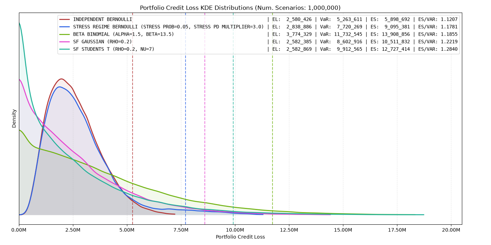
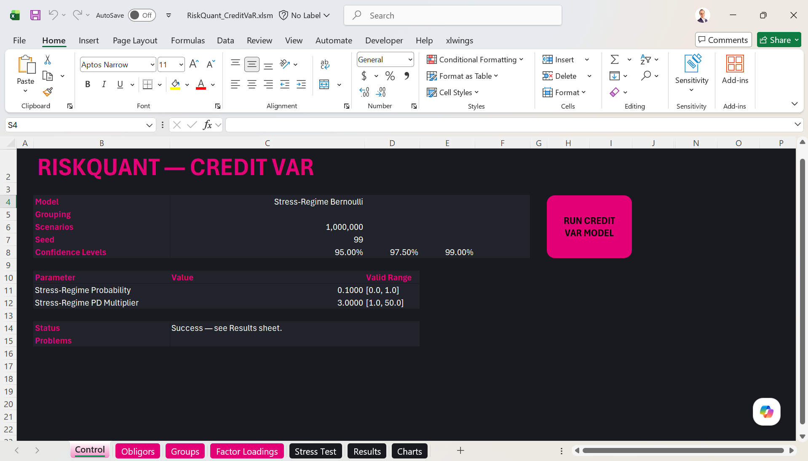
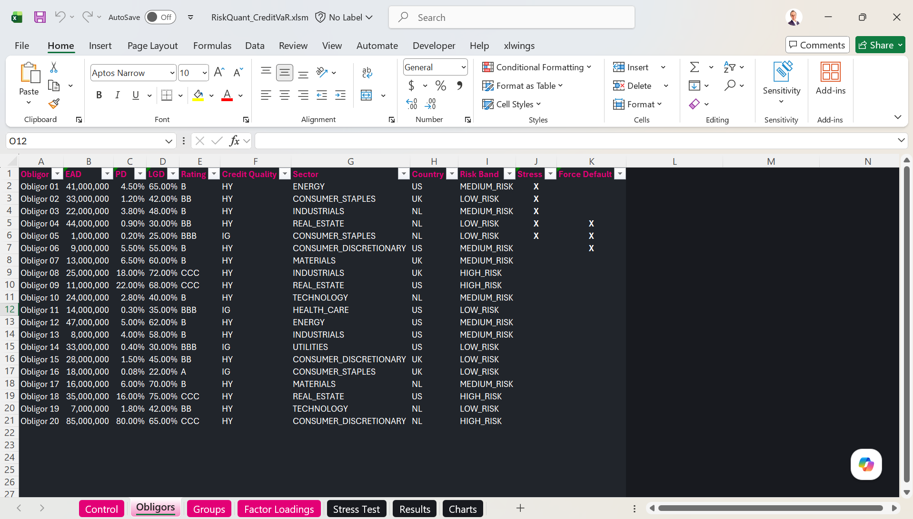
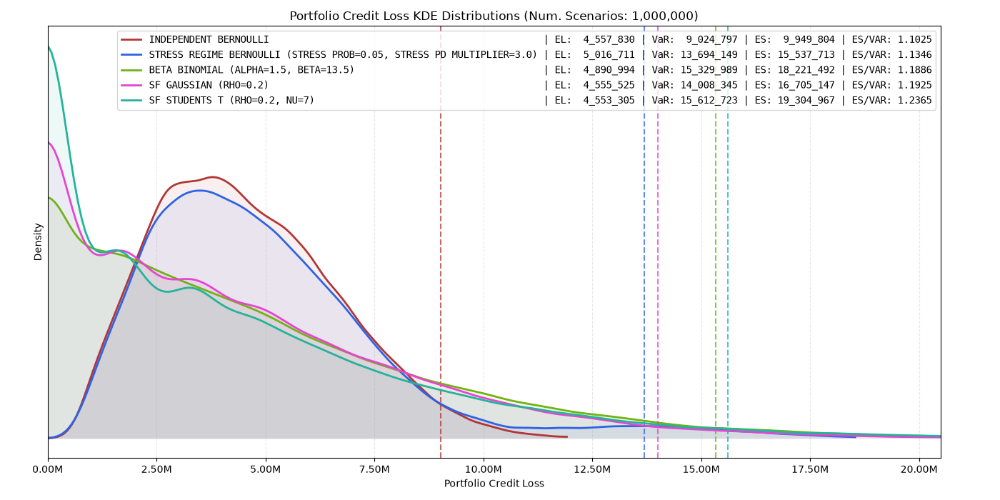
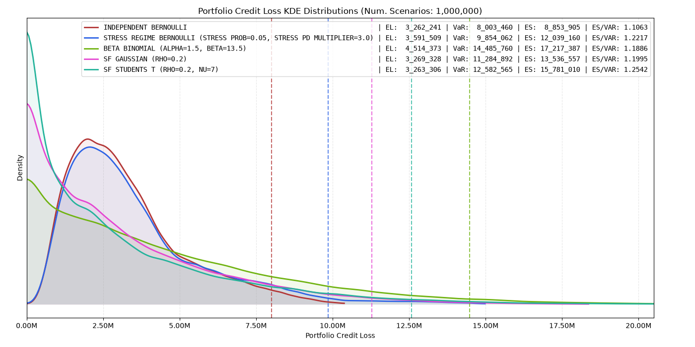
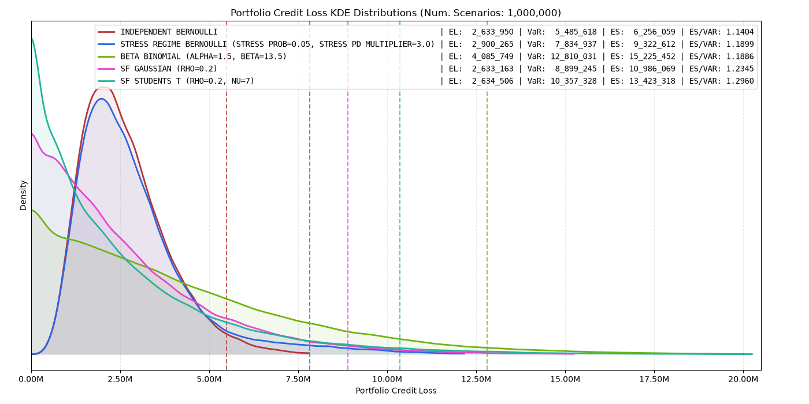

<!-- _class: lead -->

# RiskQuant · Credit VaR

## *Credit losses when counterparties default together*

{{DATE}}

<style scoped>
  p {
    font-size: 18px;
    font-style: italic;
    color: #888888;
    margin-top: 40px;
  }
</style>

---

<!-- _class: lead -->

<style scoped>
  section {
    background-color: #E30076;
    text-align: center;
  }
  h1, em {
    color: #0F1114 !important;
    text-align: center;
  }
</style>

# EXECUTIVE SUMMARY

---

<!-- _class: lead -->


# Part 0 · Current Status

## *What Credit VaR needs, what exists today, and what can run now*

> The default models and the Excel tool\* exist today. Exposure at default is the one input that needs more work.

<style scoped>
  .footnote {
    position: absolute;
    bottom: 30px;
    left: 90px;
    font-size: 12px !important;
    color: #888888 !important;
    font-style: italic !important;
  }
</style>

<div class="footnote">
  * The Excel tool is effectively deprecated. The web app replaces it, with delivery planned for November 2026.
</div>

---

# What Credit VaR Needs

Credit VaR needs four inputs. Exposure at default (EAD) and loss given default (LGD) set the size of each loss. Probability of default (PD) and default dependence set how often counterparties default, alone or together.

| # | Input | In plain terms |
|---|---|---|
| 1 | **Exposure at default (EAD)** | The amount we are owed when a counterparty defaults |
| 2 | **Loss given default (LGD)** | The share of that amount we lose after recovery |
| 3 | **Probability of default (PD)** | The chance that each counterparty defaults |
| 4 | **Default dependence** | The chance that counterparties default together |

> EAD, LGD and PD set the expected loss in most models. If a model keeps each counterparty's PD, default dependence leaves the expected loss unchanged and changes the tail. Some models replace or scale the PD, so they also change the expected loss.

---

# What We Already Have

LGD, PD and default dependence exist today. Exposure at default exists in part.

| # | Input | Status |
|---|---|---|
| 1 | EAD | **Partial** · The current EAD input is stressed Replacement Cost (RC): net MTM per netting set after any collateral, floored at zero. SA-CCR EAD is separate: alpha × (RC + PFE), where PFE (potential future exposure) is a supervisory add-on. SA-CCR covers unmargined linear trades only. |
| 2 | LGD | **Have** · input per counterparty |
| 3 | PD | **Have** · input per counterparty |
| 4 | Default dependence | **Have** · the `riskquant` model suite is built |

> Credit VaR runs today with the (stressed) Replacement Cost as EAD. A forward-looking exposure model, which gives exposure over time, is planned as a separate investment.

---

# What We Can Do Today

Each model runs on the current or stressed Replacement Cost (RC) as EAD. In each scenario, the loss is EAD × LGD, summed over the counterparties that default.

<style scoped>
  /* Shrinks the table specifically for this slide */
  table { font-size: 15px !important; }
  th, td { padding: 8px 12px !important; }
  code { font-size: 14px; }

  /* Bypasses the style-stripper by using a class */
  .footnote {
    position: absolute;
    bottom: 30px;
    left: 90px;
    font-size: 12px !important;
    color: #888888 !important;
    font-style: italic !important;
    z-index: 10;
  }
</style>


| Model | What it assumes |
|---|---|
| **Independent Bernoulli** | Each counterparty defaults on its own. No default clustering. |
| **Stress-Regime Bernoulli** | In some scenarios a shared stress state multiplies every PD. |
| **Beta-Binomial** | One shared default probability is drawn for each scenario. |
| **Single-Factor Gaussian Copula** | One shared factor drives all defaults. |
| **Single-Factor Student-t Copula** | The same shared factor, with more default clustering in extreme scenarios. |


> All five models use the same portfolio. Each model allows a different amount of default clustering, so the tail loss can differ. A deterministic upper bound (Forced Default) is also available, as are other models.

<!-- <div class="footnote">
  * Actual OTC positions and market values used. Credit assumptions (PD/LGD) are illustrative inputs. Stress cases revalue the portfolio under EUR price shocks and recompute exposure. No collateral benefit assumed.
</div> -->

---

# STX B.V. - GOO - Base Case



---

# Credit VaR is Operational Today

The Excel tool runs Credit VaR on an uploaded portfolio.

- **Configure:** Enter counterparties with EAD, PD and LGD. Select a model.
- **Run:** One click returns the loss distribution, VaR, ES and unexpected credit loss (UL).
- **Attribute:** ES contribution and incremental VaR/ES show which counterparties drive the tail.
- **Stress:** Force chosen counterparties to default in the simulation, or list them for a what-if loss. Change exposures outside the tool and re-run.
- **Exposure:** EAD is the (stressed) Replacement Cost. A forward-looking model is next.

> Each run records the model, the inputs, the seed and the software version.

> The Excel tool is deprecated in favour of a web app (planned Nov-2026).
---

# RiskQuant Credit VaR Excel Tool



---

# RiskQuant Credit VaR Excel Tool



---

<!-- _class: lead -->

<style scoped>
  section {
    background-color: #E30076;
    text-align: center;
  }
  h1, em {
    color: #0F1114 !important;
    text-align: center;
  }
</style>

# FORBIDDEN MATERIALS

---

<!-- _class: lead -->

# Part 1 · Credit VaR

## *Default dependence assumptions change the tail loss*

---

# What Credit VaR Measures

Credit VaR estimates the losses that our trading portfolio could suffer if counterparties default.

| Component | Question | Determines |
|---|---|---|
| **Exposure and LGD** | How much do we lose if a counterparty defaults? | The size of each loss |
| **Default probability** | How likely is each counterparty to default? | The expected loss |
| **Default dependence** | How likely are counterparties to **default together**? | **How strongly extreme losses cluster** |

---

# Expected Loss and Credit VaR

**Expected Loss** is the average counterparty credit loss.

**Credit VaR** is the credit loss that scenarios exceed with a small, chosen probability (e.g., 1%, which is a 99% confidence level).

| Expected Loss | Credit VaR |
|---|---|
| "What is our expected credit loss?" | "What loss could we face in a severe event?" |
| Driven by exposure, LGD and PD | Driven by exposure, LGD, PD and **default dependence** |
| Typically used to estimate the expected cost of counterparty default | Typically used to inform capital and risk appetite |

> Each model sets how strongly counterparties default together. Credit VaR includes that effect in the tail.

---

# Questions Credit VaR Helps Answer

- **How much** could we lose in a severe counterparty default event?
- **Which counterparties** contribute most to the tail loss?
- **How much** would the tail fall if we exit one counterparty?
- **What is the loss** if a chosen group of counterparties defaults together?
- **How much** does the tail change when the dependence assumption changes?

> Each model assumes a different amount of default clustering.

---

# Inputs to Credit VaR

Credit VaR uses **four** inputs. EAD and LGD set the **size of a loss**. PD and default dependence set **how often losses occur and how much they cluster**.

| Input | Question answered | Source |
|---|---|---|
| **Exposure at default (EAD)** | How much value is exposed if a counterparty defaults? | Exposure engine (RC) or an external model |
| **Loss given default (LGD)** | How much of that exposure is lost after recovery? | Counterparty table |
| **Probability of default (PD)** | How likely is each counterparty to default? | Counterparty table |
| **Default dependence** | How likely are defaults to occur together? | Model choice and parameters (ρ, ν) |

> The loss is EAD × LGD when a counterparty defaults. Default dependence links the defaults of counterparties in the same scenario.

---

# Where Credit VaR Fits

- The **exposure engine** calculates EAD. Today the EAD supplied to Credit VaR is the current or stressed Replacement Cost (RC). A forward-looking model (exposure over time) is not available yet.
- The **Credit VaR engine** simulates defaults and sums the losses.
- A credit loss arises only when a counterparty's trades have positive net replacement value at default.

```text
   Trades and MTM
     ▼
   Exposure Engine            netting · collateral · replacement cost
     ▼
   Counterparty EAD       ──►  amount owed to STX if the counterparty defaults
     ▼
   Credit VaR Engine           default simulation · dependence · aggregation
     ▼
   Loss Distribution      ──►  risk metrics (EL · VaR · ES · UL)
```

---

<!-- _class: lead -->

# Part 2 · Jump-to-Default (JTD)

## *From counterparty defaults to portfolio loss distributions*

> In each scenario, default dependence sets how many counterparties default together.

---

<!-- # Jump-to-Default (In a Nutshell)

**The event:** a counterparty defaults. Our positive net exposure to it at the time of default is the **exposure at default (EAD)**. The credit loss is **EAD × LGD**. **LGD** is the share of **EAD** that we do not recover.

We do not lend principal. Our credit exposure is the net mark-to-market that a counterparty owes us on unrealised trades. Trades offset each other only inside the same legally enforceable netting set. A counterparty can have several netting sets, and their exposures add up. Collateral reduces the amount further. Netting sets are not yet clearly defined.

**Each scenario:**

1. Take the exposure at default (EAD) of each counterparty.
2. Decide which counterparties default.
3. Apply the LGD.
4. Sum the losses over the portfolio.

Repeat for many scenarios (250,000 by default). The result is the portfolio loss distribution.

> Step 2 is the modelling choice. When one counterparty defaults, how likely is another to default in the same scenario?

--- -->

# Jump-to-Default: Summary

**The event:** a counterparty defaults. Our positive net exposure to it is the **exposure at default (EAD)**. The credit loss is **EAD × LGD**, where **LGD** is the share of **EAD** that we do not recover.

Exposure is the net mark-to-market that a counterparty owes us, after any collateral. Trades offset only inside the same legally enforceable netting set. Exposures of different netting sets add up. Netting sets are not yet clearly defined.

**Each scenario:** take the EAD of each counterparty, decide which counterparties default, apply the LGD, and sum the losses. Repeat for many scenarios. The result is the portfolio loss distribution.

> The model must state how likely another counterparty is to default in the same scenario as the first.

---

# What JTD Credit VaR Does Not Answer

JTD Credit VaR measures the loss **when default happens**.

It does not answer:

| Question | Where it sits |
|---|---|
| How large could exposure become before default? | CCR modelling |
| What is the loss from a sudden move in market prices? | Market risk |
| Does exposure increase as the counterparty's credit quality falls (wrong-way risk)? | Not modelled. The model does not capture wrong-way risk. In the simulation, EAD is a fixed input. |
| How long does close-out take after default? | CCR modelling |
| How does credit quality fall before default? | Not modelled. This needs a credit migration model. |

> JTD Credit VaR measures default loss only. It is one part of total counterparty risk.

---

# What Drives Expected Loss and Tail Loss

| Driven by exposure, LGD and PD | Affected by default dependence |
|---|---|
| **Expected Loss** | **The tail: VaR and ES** |
| Same for every model that keeps each counterparty's PD | Can differ strongly between models |

Example: EUR 100m exposure, 40% recovery → **EUR 60m loss if it defaults.**

Models that keep the counterparty's PD give it the same expected loss. They differ in how often it defaults in the same scenario as other counterparties.

---

# Five Models on the Same Portfolio

The common question: **when one counterparty defaults, how likely are others to default too?**

| # | Model | Assumption added |
|---|---|---|
| 0 | Forced Default (bound) | Every counterparty defaults. No probability or dependence. |
| 1 | Independent Bernoulli | Defaults are unrelated |
| 2 | Beta-Binomial | Default rates can move higher or lower together |
| 3 | Stress-Regime Bernoulli | The market can enter a crisis state |
| 4 | Gaussian Copula | Counterparties share common risk drivers |
| 5 | Student-t Copula | Extreme tail dependence |

> Independent Bernoulli and the copulas keep each counterparty's PD, so their expected loss is the same (apart from simulation error). Beta-Binomial and Stress-Regime change the PD.

---

# 0 · Forced Default (bound): *all counterparties default*

**Intuition:** every counterparty defaults in every scenario. PD plays no part. This is a deterministic bound. It has no dependence assumption.

**Answers:** *what is the largest default loss for the given EAD and LGD?*

| Strengths | Weaknesses |
|---|---|
| Needs only EAD and LGD | Not a realistic scenario |
| Gives an upper bound for the given EAD and LGD | Not suitable as a capital estimate |

**Use it for:** an upper-bound check, new portfolios with no PD history, and hard stress cases.

> For the same EAD and LGD, no model gives a loss above this value. A change in EAD or LGD changes the bound.

---

# 1 · Independent Bernoulli: *no default clustering*

**Intuition:** each counterparty defaults with its own PD. A default does not change the chance of any other default.

**Answers:** *what does the loss look like if defaults are unrelated?*

| Strengths | Weaknesses |
|---|---|
| Simple, fast, gives a full distribution | Does not allow default clustering |
| Captures single-counterparty concentration | **Understates the tail and overstates diversification** |

**Use it for:** a baseline without default clustering. Compare the other models with it.

> Counterparties often depend on the same economic conditions. This model ignores that, so it overstates diversification.

---

# 2 · Beta-Binomial: *"one shared default rate"*

**Intuition:** the model draws one default probability for the whole portfolio in each scenario. Every counterparty uses that probability. In a high-rate scenario, many counterparties default together.

**Answers:** *what happens when the portfolio default rate changes from scenario to scenario?*

| Strengths | Weaknesses |
|---|---|
| Creates default clustering without specifying risk factors | One pool: no sector, geography or counterparty drivers |
| Introduces volatility in the portfolio default rate | Ignores each counterparty's own PD |

**Use it for:** portfolios where default uncertainty matters and a factor model is not required.

> The Beta parameters set the average PD for every counterparty.

---

# 3 · Stress-Regime Bernoulli: *a shared stress state*

**Intuition:** in some scenarios a shared stress state is active. In those scenarios the model multiplies every PD by a fixed factor, up to 100%.

**Answers:** *what happens when a defined stress state raises all PDs together?*

| Strengths | Weaknesses |
|---|---|
| Makes default dependence explicit and interpretable | Assumes only two states: normal and stress |
| Easy to link losses to defined stress scenarios | Requires judgement on stress severity and likelihood |

**Use it for:** stress testing, limit discussions and adverse-scenario analysis.

> One shared stress state links all counterparties. The state also raises expected loss.

---

# 4 · Gaussian Copula: *one shared factor*

**Intuition:** each counterparty has its own component and a shared component. When the shared factor is low, many counterparties weaken together and defaults cluster.

**Answers:** *how much do shared drivers reduce our diversification?*

| Strengths | Weaknesses |
|---|---|
| Standard market model (Vasicek, Basel ASRF) | One shared factor only |
| Asset correlation (ρ) controls clustering: one value by default, optional per-counterparty values | Gaussian tails understate joint extreme defaults |

**Use it for:** portfolio tail risk measurement and counterparty risk capital.

> The Student-t copula adds tail dependence to this model.

---

# 5 · Student-t Copula: *stronger tail dependence*

**Intuition:** the same shared factor as the Gaussian copula, plus a shared random scale. In extreme scenarios, counterparties are more likely to default together than under the Gaussian copula.

**Answers:** *how large can the loss become when defaults cluster in the tail?*

| Strengths | Weaknesses |
|---|---|
| Captures stronger tail dependence | One extra parameter (degrees of freedom, ν) needs a value |
| Allows defaults to cluster in extreme scenarios | Tail loss can exceed the Gaussian copula result at the same ρ, depending on the portfolio and the confidence level. |

**Use it for:** extreme portfolio losses and stress scenarios where diversification falls.

> In extreme scenarios, diversification between counterparties falls.

---

<!-- # Comparing the Models

| Model | Realism | Transparency | Tail Capture | Data Need | Business Fit |
|---|---|---|---|---|---|
| Forced Default (bound) | n/a | High | n/a | Minimal | Stress bound |
| Independent Bernoulli | Low | High | Low | Low | Baseline view |
| Beta-Binomial | Med | High | Med | Low | Portfolio stress |
| Stress-Regime | Med | High | Med-High | Med | Scenario analysis |
| Gaussian Copula | High | Med | Med | Med-High | Core risk view |
| Student-t Copula | **High** | Med | **High** | Med-High | Extreme tail view |

> Simple models are easier to explain. Richer models capture more dependence. No single model is best in every column, so we run several.

--- -->

# Comparing the Models

| Model | Dependence Structure | Transparency | Parameter Inputs | Typical Use |
|---|---|---|---|---|
| Forced Default | All counterparties default together | High | EAD and LGD | Upper-bound stress |
| Independent Bernoulli | No default dependence | High | Individual PDs | Baseline risk |
| Beta-Binomial | Common random default probability | High | Beta distribution parameters | Simplified default clustering |
| Stress-Regime | Common discrete stress state | High | Stress probability and PD multiplier | Scenario analysis |
| Gaussian Copula | One shared systematic factor; common or per-counterparty asset correlations (ρᵢ). No asymptotic tail dependence. | Medium | Global ρ (default 0.15), optional per-counterparty ρᵢ, or Basel R(PDᵢ) | Systematic default dependence |
| Student-t Copula | Same factor structure as Gaussian, plus a shared random scale. Symmetric tail dependence. | Medium | Same ρ inputs as Gaussian, plus degrees of freedom (ν, default 7.0) | Joint extreme-default scenarios |

> Parameter values are configured by the user or derived from a specified formula. The copula parameters are not empirically calibrated within RiskQuant. Each model makes different assumptions about how defaults occur together.

<style scoped>
  table { font-size: 14px; }
  th, td { padding: 7px 12px; }
  blockquote { font-size: 18px; }
</style>

---

# Which Model Answers Which Question?

| The question we need to answer | Model |
|---|---|
| What is the loss if every counterparty defaults? | Forced Default (bound) |
| What if defaults are independent? | Independent Bernoulli |
| What if the portfolio's default probability varies between scenarios? | Beta-Binomial |
| What if a shared stress regime raises default probabilities? | Stress-Regime Bernoulli |
| What if counterparties share a common source of default risk? | Gaussian Copula |
| What if defaults become more strongly clustered in extreme scenarios? | Student-t Copula |

> Compare the models to understand how different assumptions about default probabilities and default dependence affect the loss distribution and its tail.

---

<!-- _class: lead -->

# Part 3 · Reading the Output

## *Metrics and attribution*

> Credit VaR also shows which counterparties drive the tail.

---

# Risk Metrics

| Metric | Reads As | Typically Feeds |
|---|---|---|
| **Expected Loss (EL)** | average counterparty default loss | expected credit cost |
| **Loss volatility (σ)** | how much the portfolio loss varies | unexpected loss |
| **VaR** | the loss exceeded with probability 1 − α (α = confidence level) | risk-appetite limits |
| **Expected Shortfall (ES)** | the *average* loss in the scenarios beyond VaR | internal capital |
| **Unexpected Credit Loss (UL)** | alternative measures: VaR − EL (VaR-based) and ES − EL (ES-based) | internal capital |

> VaR is one point of the loss distribution. ES is the average of all losses beyond that point.

Models that keep each counterparty's PD give the same EL, apart from simulation error. VaR and ES can differ between models.

---

# Incremental VaR & ES: *what each counterparty adds*

Hold the portfolio constant, remove one counterparty and re-measure the tail. The difference is its incremental risk.

> `incremental_risk(i) = risk(portfolio) − risk(portfolio excl. i)`

**Answers:** *how much would the tail fall if we exit this counterparty?*

| Property | Consequence |
|---|---|
| Computed for both VaR and ES | Same simulated losses, so no new simulation run |
| **Not additive** | Incremental values do not sum to portfolio risk |

<!-- **Use it for:** limit discussions, novation and unwind decisions for existing counterparties. A new counterparty or trade needs a new run with the changed EAD. -->

**Use it for:** counterparty limit discussions, assessing potential exits or unwinds, and identifying counterparties whose exposure may warrant transfer through novation.

A proposed novation requires a new run reflecting the receiving counterparty and its resulting EAD.

---

# Contribution ES

Contribution ES splits today's ES across the counterparties. The contributions add up exactly to the portfolio ES.

> `contribution_ES(i)` = average loss of counterparty `i` in the portfolio's worst `1−α` share of scenarios.

> `portfolio_ES = sum_i contribution_ES(i)`

---

<!-- _class: lead -->

<style scoped>
  section {
    background-color: #E30076;
    text-align: center;
  }
  h1, em {
    color: #0F1114 !important;
    text-align: center;
  }
</style>

# APPENDIX


---

<!-- _class: lead -->

# Appendix A: STX Credit VaR


---


# STX B.V. - GOO - Base Case


---


# STX B.V. - GOO - Stressed (+20%)



---

# STX B.V. - GOO - Stressed (-20%)



---

# STX B.V. - GOO - Random Up/Down 10%-20% (PC Level)


